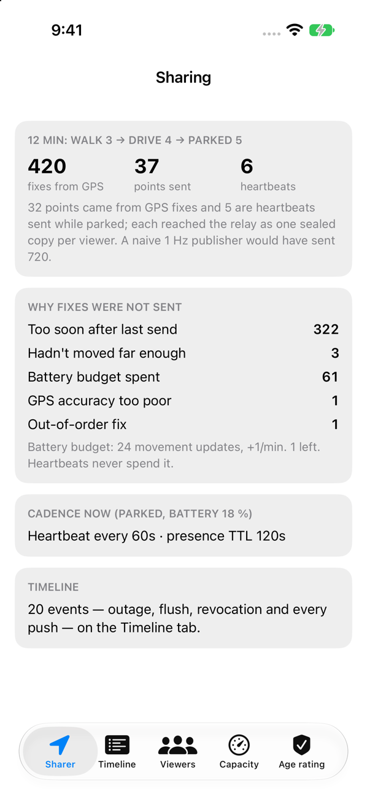
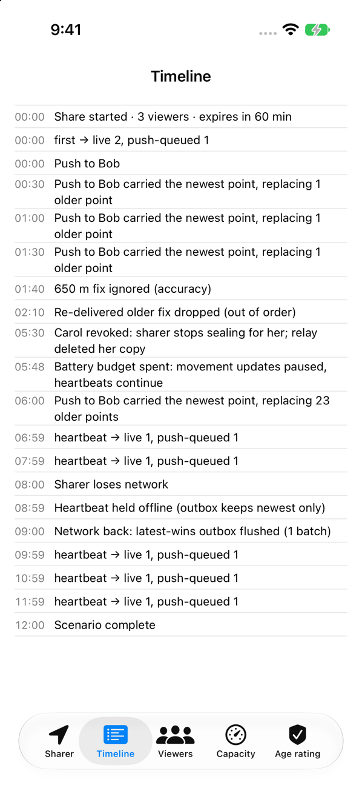
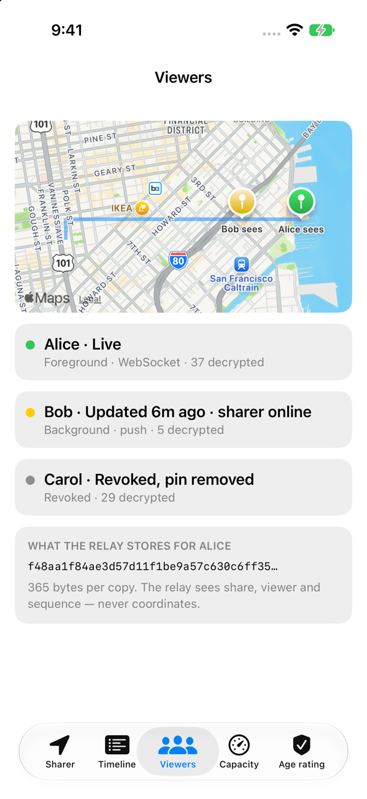
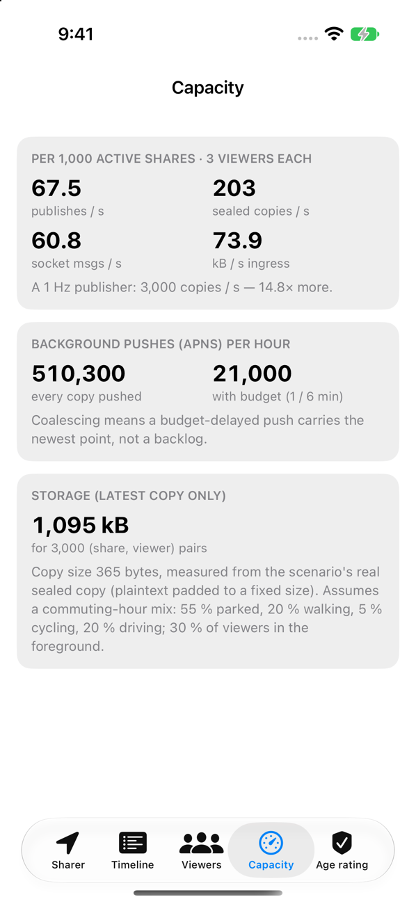
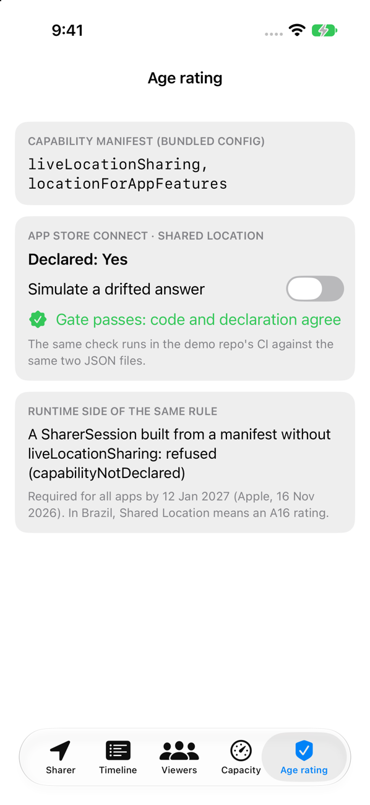

# Live Location — demo app

**Twelve minutes of live location sharing, run through a real system on the iOS Simulator: 420 GPS fixes and a parked-heartbeat timer produce 37 end-to-end-encrypted points, two viewers end up with pins of very different ages, a third is revoked, and the relay never sees a coordinate.**

[](https://github.com/rajatslakhina/live-location-share-demo-app/actions/workflows/ci.yml)

This is the companion app for **[LiveLocationKit](https://github.com/rajatslakhina/live-location-share-kit)**, a Swift package that answers the "design live location sharing" interview question in working code. The app is a separate Xcode project that consumes the package the way a product team would: as a **remote Swift package**. The version requirement is "up to next major from 2.1.5". The exact release is pinned by the committed `Package.resolved`, and CI builds with `-onlyUsePackageVersionsFromResolvedFile`.

## Why this matters

Since 16 Nov 2026, App Store Connect asks every app whether it shares a user's real-world location with other people. This is the **Shared Location** age-rating descriptor: answers are due by 12 Jan 2027, and in Brazil a "Yes" means an A16 rating. The map pin is the easy part. The interesting part is everything a naive "send my location to everyone every second" build gets wrong:

- battery drain;
- a parked phone spamming identical points;
- a server that can read everyone's location;
- revocation that depends on the server;
- background push costs;
- nothing linking the code to the age-rating answer.

Each tab below shows one of those handled by the library.

## What you see

| Sharer | Timeline | Viewers |
|---|---|---|
|  |  |  |

| Capacity | Age rating |
|---|---|
|  |  |

The app runs one deterministic scenario on a manual clock: **walk for 3 min, drive for 4 min, then park for 5 min**, with the battery falling from 62 % to 18 %. It goes through the library's real types: `SharerSession` → `PerViewerSealer` → `LocationRelay` → a foreground stream or a budgeted push → `PointInbox` per viewer.

- **Sharer.** Every GPS fix goes through `PublishGate`. 32 fixes become points; the other 388 are suppressed, each with a reason:
  - too soon after the last send;
  - not moved far enough;
  - **battery budget spent** (the demo's budget is deliberately small, 24 movement updates, so you can watch it run dry while driving);
  - one 650 m cell-tower-grade fix (poor accuracy);
  - one re-delivered older fix (out of order).

  Once parked, the phone sends only heartbeats (5 of the 37 points), which never spend the budget. A network outage at 08:00 is absorbed by the latest-wins outbox and flushed at 09:00. The **Timeline** tab lists the key moments: the poor and re-delivered fixes, Carol's revocation, the point where the budget runs dry, the outage and the flush, and every push to Bob.
- **Viewers.** All three viewers end up with a different picture:
  - **Alice** keeps the app open (the WebSocket path) and is **Live** at the parked spot.
  - **Bob** is backgrounded. He gets pushes only within the relay's per-viewer budget: a burst of 4, then one every 6 min, each carrying the newest point. His pin is therefore an en-route point from minute 6. Because the relay reports the sharer as online, he reads **Updated 6m ago · sharer online**, not "last seen". That is the honest cost of the push budget. The demo uses a 6-minute refill so that Bob's last push lands mid-drive; the library README's capacity figures assume 5 minutes.
  - **Carol** is **revoked** at 05:30. The sharer's device stops sealing for her, the relay deletes her copy, and her pin is removed.

  Every viewer pinned the share's public key from the invitation, so the relay cannot forge a point. The bottom card shows what the relay actually stores for Alice: ciphertext.
- **Capacity.** `FanoutLoadModel` per 1,000 active shares with 3 viewers each, using the copy size measured from this scenario's real sealed copy and the scenario's own push budget.
- **Age rating.** The app bundles two files: `Demo/Config/capabilities.json` (the capability manifest) and `Demo/Config/age-rating.json` (the exported App Store Connect answer).
  - The tab opens on the checked-in answer, and `AgeRatingGate` passes.
  - **Simulate a drifted answer** shows the blocking error CI would raise.
  - Below that, a `SharerSession` built from a manifest *without* the capability is refused at runtime.

## Decisions and trade-offs

- **A remote package pinned by `Package.resolved`,** not a local path dependency or a git submodule. The app builds against exactly what a product team would get from the release tag, and CI resolves it with `-onlyUsePackageVersionsFromResolvedFile`, so a new library tag cannot change the demo silently.
- **The scenario lives in the library (`LiveLocationUI`), not in the app target.** That way the library's headless test pins the scenario's headline numbers (420 / 37 / 6, Alice's 365-byte copy, Bob's "6m ago"), and the app stays a thin shell that loads its two config files and shows the view. The cost: the app has almost no code of its own to read.
- **A manual clock and a scripted route,** not real CoreLocation in the Simulator. Every run, screenshot and CI build sees the same 12 minutes. The cost is that the `CLLocationUpdate.liveUpdates` adapter is not exercised here.
- **The relay runs in-process,** not as a mock backend. The demo drives the real `LocationRelay` state machine, so what it shows is what the library does, without pretending to have a deployed server.
- **A 6-minute push refill instead of the library's 5-minute default,** so Bob's last push lands mid-drive and the "behind" state is visible. The Capacity tab uses the same 6 minutes, so its push figure differs from the library README's.
- **The age-rating answer is a checked-in file with a gate in CI,** not a manual check. A drifted answer fails the build, and a control step proves the gate can fail.

## How to run it

1. `git clone https://github.com/rajatslakhina/live-location-share-demo-app.git && cd live-location-share-demo-app`
2. Open `Demo.xcodeproj`. It was built and run locally with Xcode 27.2, and CI builds it with the default Xcode on GitHub's `macos-15` runner; it needs the Swift 6 toolchain (Xcode 16+). Xcode resolves `LiveLocationKit` from GitHub.
3. Select the **Demo** scheme and any iPhone Simulator (iOS 17+), then choose **Build & Run**.
4. Optional: the scheme includes disabled launch arguments, `-tab sharer|timeline|viewers|capacity|gate`, for opening a specific tab.

No location permission is needed because the route is scripted. The scenario's run time was not measured inside the app; the library's headless test of the same scenario takes 0.03–0.09 s per run on macOS.

To run the age-rating gate yourself:

```sh
swift run --package-path Tools/AgeRatingCheck age-rating-check Demo/Config/capabilities.json Demo/Config/age-rating.json
```

## Verification: exactly what happened

- **Simulator run, done for this exact version.**
  - **Build:** the app was built with `xcodebuild` against LiveLocationKit **2.1.5**, resolved from GitHub at the commit pinned in `Package.resolved`. Xcode was 27.2, and code signing was disabled (`CODE_SIGNING_ALLOWED=NO`).
  - **Run:** a dedicated iPhone 17 Pro Simulator running iOS 27.2, created with `simctl create` for this run. The app was installed and launched once per tab with `-tab sharer|timeline|viewers|capacity|gate`, and each time the process was confirmed alive 9 s after launch.
  - **Screenshots:** the five above were captured from those launches with `simctl io screenshot`. The status bar was overridden to 9:41 with `simctl status_bar`, and the images were resized to 1300 px tall.
- **CI** has two jobs on `macos-15` (the runner's default Xcode), triggered by pushes to `main`, tags and pull requests (see the [Actions tab](https://github.com/rajatslakhina/live-location-share-demo-app/actions)):
  1. `xcodebuild -resolvePackageDependencies` followed by `xcodebuild build -destination 'generic/platform=iOS Simulator'`. This proves the pinned remote package resolves from GitHub and that the app compiles against it. CI builds the app but does not launch it.
  2. The age-rating gate runs against the two bundled JSON files, plus a control step that feeds it a drifted answer and requires it to fail. A first step also checks that the gate tool and the app pin the same library version.
- The library's own checks live in [its repo](https://github.com/rajatslakhina/live-location-share-kit): unit tests, a headless test that pins this scenario's numbers, the mutation check and the iOS build.

## Limits worth knowing

- **The relay runs in-process.** It is the library's server state machine, not a deployed backend. "WebSocket" is an `AsyncStream`, and "push" is what `drainPushes()` would hand to APNs. There is no real APNs, ActivityKit or network.
- **The scenario is scripted.** The route, battery, outage, poor fix and re-delivered fix are fixed, so every run is identical. The library's `CLLocationUpdate.liveUpdates` adapter is not used here.
- **Keys are generated in-process** and the invitation is simulated. Real key distribution and verification are out of scope; see the library's limits.

MIT licensed.
